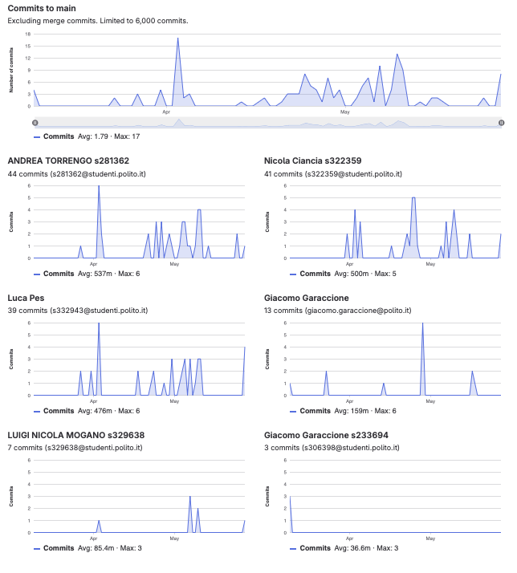

# Gruppo 46

## Valutazione deliverable V1

| gruppo | context diagram | business model | stakeholder | stories | interface | FR | NFR | use cases diagram | use cases | scenario | Glossary | DeploymentDiagram | functionality | estimation doc | precisione valori estimation | valutazione |
| --- | --- | --- | --- | --- | --- | --- | --- | --- | --- | --- | --- | --- | --- | --- | --- | --- |
| - | 1 | 0.5 | 0.5 | 1 | 1 | 3 | 3 | 1 | 5 | 5 | 5 | 2 | 1 | 2 | 2 | 33 |
| 46 | 95 | 100 | 100 | 85 | 95 | 100 | 100 | 100 | 100 | 100 | 75 | 90 | 90 | 75 | 92.82 | 94.13 |

## Valutazione deliverable V2

| gruppo | context diagram | business model | stakeholder | stories | interface | FR | NFR | ACCESS RIGHTS | use cases diagram | use cases | scenario | Glossary | DeploymentDiagram | functionality | estimation | precisione valori estimation | valutazione |
| --- | --- | --- | --- | --- | --- | --- | --- | --- | --- | --- | --- | --- | --- | --- | --- | --- | --- |
| - | 1 | 0.5 | 0.5 | 1 | 1 | 3 | 2 | 1 | 1 | 5 | 5 | 5 | 2 | 1 | 2 | 2 | 33 |
| 46 | 100 | 100 | 100 | 100 | 100 | 100 | 100 | 100 | 100 | 100 | 100 | 100 | 80 | 100 | 95 | 94.63 | 99.69 |

Le percentuali di v2 sono state riscalate in quanto la media pesata delle percentuali portava alcuni gruppi oltre al 100%.

## Valutazione codice e test (V2 + V3)

| Test Unit Totali | Test Unit Passati | Statement Coverage Unit | Branch Coverage Unit | Function Coverage Unit | Line Coverage Unit | Test Integration Totali | Test Integration Falliti | Statement Coverage Integration | Branch Coverage Integration | Function Coverage Integration | Line Coverage Integration | Correttezza V2 | Correttezza V3 | valutazione |
| --- | --- | --- | --- | --- | --- | --- | --- | --- | --- | --- | --- | --- | --- | --- |
| 1 | 0.5 | 2 | 2 | 1 | 1 | 1 | 0.5 | 2 | 2 | 1 | 1 | 16 | 2 | 33 |
| 75 | 100 | 100 | 100 | 100 | 100 | 75 | 100 | 100 | 75 | 100 | 100 | 83.1932773109244 | 100 | 88.82 |

 Unit e integration test prodotti dai gruppi sono stati eseguiti con la versione V2 del codice.

## Risultati Progetto

| Deliverable | Punteggio | Peso |
| --- | --- | --- |
| **Documenti V1** | 94.13% | 6 |
| **Documenti V2** | 98.35% | 2 |
| **Codice e Test** | 88.82% | 22 |
| **Timesheet** | 100.0% | 3 |
| **Valutazione** | 30.16 | 33 |
| **Valutazione** | 12.06 | 13.2 |

## Calcolo pesi progetto per singolo studente

| cognome | nome | email | gruppo | commit studente | commit totali | commit sul totale | coefficiente catme | coefficiente pesato | coefficiente progetto |
| --- | --- | --- | --- | --- | --- | --- | --- | --- | --- |
| CIANCIA | NICOLA | s322359@studenti.polito.it | 46 | 41 | 131 | 0.31 | 1.02 | 0.88 | 1.00 |
| MOGANO | LUIGI NICOLA | s329638@studenti.polito.it | 46 | 7 | 131 | 0.05 | 0.93 | 0.75 | 0.86 |
| PES | LUCA | s332943@studenti.polito.it | 46 | 39 | 131 | 0.30 | 1.02 | 0.88 | 1.00 |
| TORRENGO | ANDREA | s334072@studenti.polito.it | 46 | 44 | 131 | 0.34 | 1.00 | 0.87 | 0.99 |

 I pesi del progetto sono ottenuti per l'80% dal valore calcolato da CATME e per il 20% dalla percentuale dei commit del singolo studente sul totale dei commit effettuati dagli studenti dello stesso gruppo. Il risultato è stato poi riscalato in modo che il punteggio più alto del gruppo ottenesse 1.

## Studenti

| Nome | Matricola | Email | Bonus | Voto Primo Appello | Voto Progetto | Voto Finale |
| --- | --- | --- | --- | --- | --- | --- |
| LUCA PES | 332943 | s332943@studenti.polito.it | 1 | 17.48 | 12.02 | 30 |
| ANDREA TORRENGO | 334072 | s334072@studenti.polito.it | 1 | 16.8 | 11.90 | 30 |
| NICOLA CIANCIA | 322359 | s322359@studenti.polito.it | 0 | 13.28 | 12.06 | 25 |
| LUIGI NICOLA MOGANO | 329638 | s329638@studenti.polito.it | 1 | 11.6 | 10.36 | 23 |
